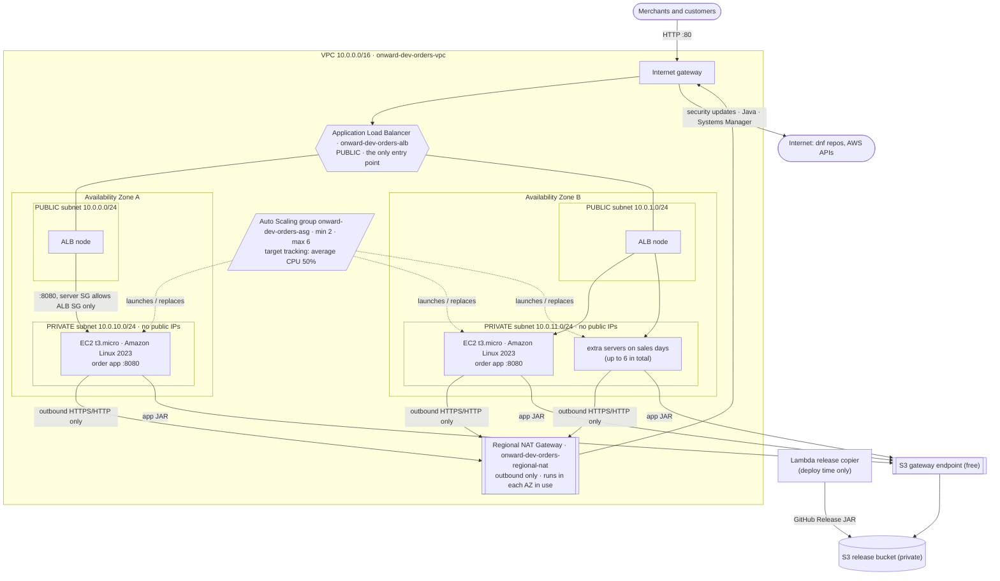
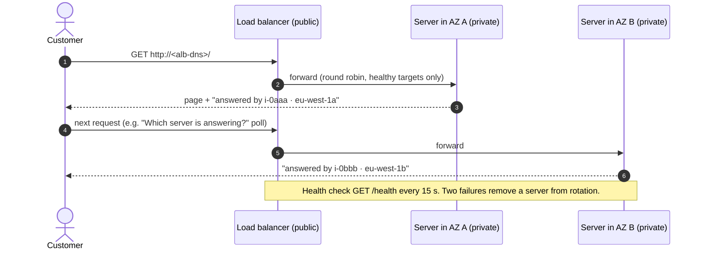
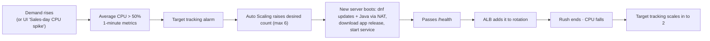
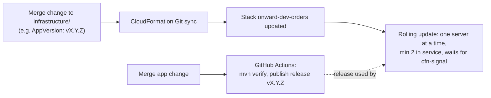

# Architecture: Handling Sales Day Demand

Region `eu-west-1`, environment `dev`, stack `onward-dev-orders`. Every resource below is in [`infrastructure/template.yaml`](../../infrastructure/template.yaml).

**Editable diagram:** [`onward-sales-day-architecture.drawio`](onward-sales-day-architecture.drawio). Open it at [app.diagrams.net](https://app.diagrams.net) with *File → Open from → Device*, or use *Arrange → Insert → Advanced → From Text… → XML* to paste it into an existing diagram. It uses draw.io's built-in AWS 2021 icons: AWS Cloud → Region → VPC → Availability Zones → public and private subnets, the ALB, the Regional NAT, the Auto Scaling group, and numbered traffic and change flows. The Mermaid diagrams below show the same design in text form, so GitHub renders them.

## 1. Resources inside the VPC: public vs private

| | Public | Private |
| --- | --- | --- |
| Resources | Application Load Balancer, Regional NAT Gateway (public IPs), internet gateway | EC2 servers (Auto Scaling group) |
| Inbound from internet | ALB on port 80 only | **None.** No public IP, and the security group only admits port 8080 from the ALB security group |
| Outbound to internet | n/a | Through the NAT gateway only: security updates, Java, the app JAR from GitHub Releases, and Session Manager |
| Admin access | n/a | Session Manager over the outbound connection. No SSH or RDP port is open |

## 2. How a request flows

## 3. How capacity changes on a sales day

## 4. How a server gets what it needs

1. The launch template boots the latest **Amazon Linux 2023** AMI (resolved from the public SSM parameter) on `t3.micro`, with IMDSv2 required and an encrypted 8 GB gp3 disk.
2. The user data:
   - installs security updates and Java 21 through the NAT gateway;
   - copies `onward-orders.jar` for `AppVersion` from the **private S3 release bucket** through the **S3 gateway endpoint**, so this step needs no internet;
   - runs the app as a `systemd` service that restarts on failure;
   - waits for `/health`, then sends `cfn-signal`.

   The S3 copy is made once, at deploy time, by a small Lambda custom resource that downloads the GitHub Release. Launching or replacing a server therefore never depends on GitHub being available.
3. The Auto Scaling group uses **ELB health checks**, so a server whose app stops answering is replaced, not just one whose hardware fails.

## 5. How changes are delivered

## 6. Failure behaviour

- **A server dies, or its app stops.** The ALB stops sending to it after three failed health checks (about 45 seconds). Auto Scaling terminates it and launches a replacement.
- **GitHub or the internet is unavailable.** New servers still install the app from the private S3 copy through the gateway endpoint.
- **A whole Availability Zone is lost.** The server in the other zone keeps answering through the ALB node in that zone. Auto Scaling launches replacements in the healthy zone, and the Regional NAT keeps serving the surviving zone.
- **Load drops after a sale.** Target tracking removes servers gradually, back to the minimum of 2.
