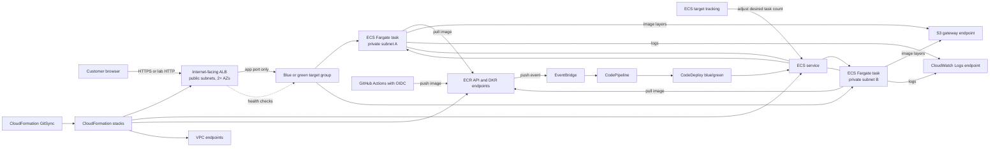

# Lab 1 architecture and delivery flow

This is the target architecture required by the brief: one public entry point, private ECS Fargate tasks, VPC endpoints instead of NAT, and blue/green releases. The current CloudFormation files are an older EC2 draft, so this is not yet deployed or fully implemented in IaC. Capacity values and AWS Region remain explicit inputs for cost discovery.

## Application delivery

```text
Developer merges application change
  -> GitHub Actions builds Java app image
  -> GitHub OIDC exchanges a short-lived token for AWS credentials
  -> workflow pushes immutable commit-SHA image and a release event tag to ECR
  -> ECR image-push event reaches EventBridge
  -> EventBridge starts CodePipeline
  -> pipeline reads deployment descriptors from the app repository
  -> CodeDeploy ECS blue/green action creates replacement task set
  -> test listener and health checks verify replacement tasks
  -> traffic shifts to new task set; alarms/health failures cause rollback
```

## Infrastructure delivery

```text
Infrastructure change merged to infrastructure repository
  -> CloudFormation GitSync observes configured branch/template/deployment file
  -> CloudFormation creates or updates stacks from version-controlled templates
  -> root template creates network, security, load balancer, ECR/ECS, delivery, and monitoring resources
```

GitSync is configured against a specific infrastructure repository, branch, template, and stack deployment file. Keep nested templates colocated in the repository or publish them using a reproducible pipeline; ensure each child-template change updates a GitSync-tracked artifact. Do not rely on an S3 object changing by itself to trigger GitSync.

## Request and private connectivity flow



Task security group accepts application traffic only from the ALB security group and HTTPS egress only to endpoint security groups. The private task subnets have no NAT gateway and no general internet route. The ALB is the only public application endpoint. Configure ACM/HTTPS for a real domain; plain HTTP may be used for a temporary lab demonstration if the brief allows it.

## Blue/green deployment sequence

1. GitHub Actions builds and tags the app image with the commit SHA, then publishes it to ECR.
2. EventBridge filters ECR `PUSH` events for the configured repository and release tag, then starts the deployment pipeline.
3. CodePipeline combines the ECR image detail artifact with `taskdef.json` and `appspec.yaml` from the app source repository.
4. CodeDeploy starts a replacement ECS task set in the alternate target group.
5. The test listener and target health checks verify the replacement. CodeDeploy shifts production traffic according to the deployment configuration.
6. CloudWatch alarms and CodeDeploy deployment settings stop or roll back an unhealthy release. Keep the previous task set available for the configured bake period.

## Scaling and failure behavior

ECS service auto scaling uses target tracking (for example, average CPU or ALB requests per target) with documented minimum and maximum task counts. A Fargate task failure is replaced by ECS. If an AZ fails, the service scheduler places replacement tasks in healthy AZs, subject to configured capacity. The ALB sends traffic only to healthy targets. This is application availability, not durable order storage: current demonstration orders are in-memory and disappear when a task is replaced.

## Learning and cost assumptions

No resource quantities are presented as a final estimate. The AWS Pricing Calculator inventory and quiet/peak assumptions are in the [discovery report](../discovery-report/README.md). Key cost drivers are Fargate task-hours and size, ALB hours/LCUs, three interface endpoint-hours, CloudWatch logs, ECR storage, data transfer, and deployment/build frequency. There is no NAT gateway in this design.

The current code repository is still combined. The final hand-in should link separate application and infrastructure repositories as the client brief requires.
