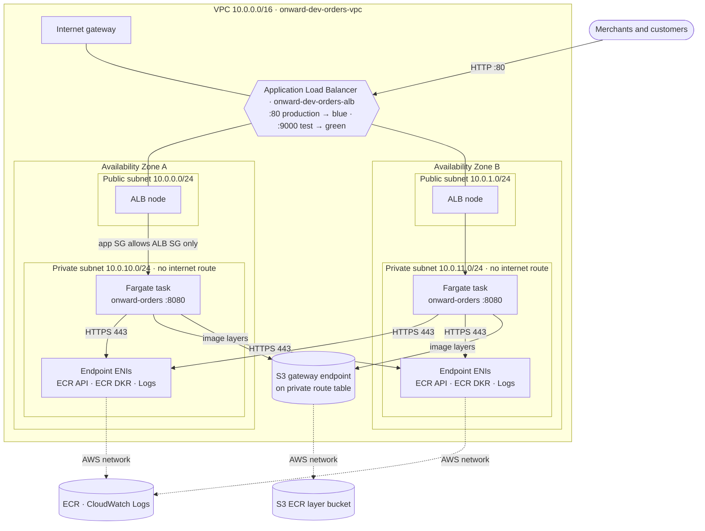
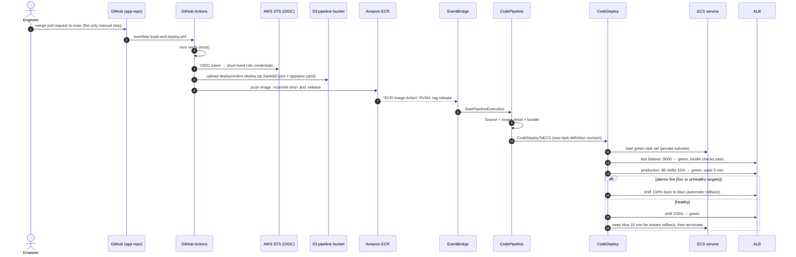
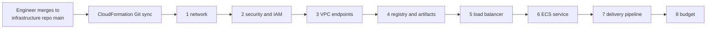

# Architecture: Onward orders on ECS Fargate with blue/green delivery

Region `eu-west-1`, environment `dev`. Every resource below is defined in the [infrastructure templates](../../infrastructure/README.md) and deployed by CloudFormation Git sync.

## 1. Resources inside the VPC

| Security rule | Where it is enforced |
| --- | --- |
| One public entry point | Only the ALB is in public subnets. Tasks have `AssignPublicIp: DISABLED`. |
| No internet path for the application | The private route table has only the `local` route and the S3 gateway route. There is no NAT gateway. |
| Tasks accept only load-balancer traffic | The app security group allows port 8080 from the ALB security group only. |
| Endpoints accept only task traffic | The endpoint security group allows port 443 from the app security group only. |

## 2. Delivery pipeline: how a change reaches customers

## 3. Infrastructure delivery

Each numbered stack has its own deployment file in `infrastructure/deployments/`. Stacks share values through CloudFormation exports named `onward-<env>-<stack>-<Value>`. A change to a template or its deployment file is deployed when it is merged.

## 4. Scaling and failure behaviour

- **Container failure.** The ALB stops sending to an unhealthy task, and ECS replaces it to keep the desired count.
- **Availability Zone loss.** The other zone's task keeps serving behind the ALB. ECS starts replacements in the healthy zone, and the endpoints exist in both zones.
- **Busy days.** CPU target tracking at 50% raises the task count from 2 up to 6, then removes tasks once load drops (120-second scale-in cooldown).
- **Idle.** An optional schedule scales to 0 tasks at night and on weekends. Deleting the stacks removes the remaining hourly cost; see the [cost estimate](../cost/README.md).
- **Data.** Demo orders are in memory per task. They are lost when a task is replaced and are not shared between tasks.
