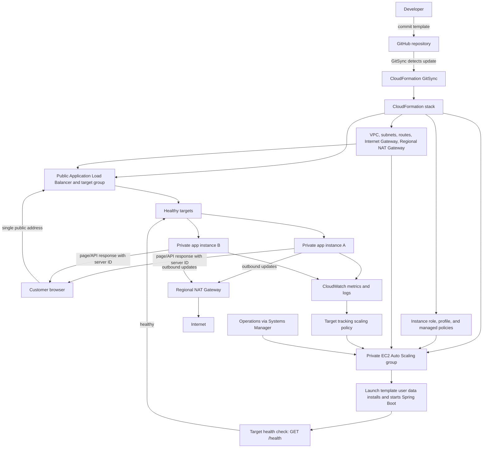

# Lab 1 architecture and flow

This page shows how the code, CloudFormation deployment, network, application requests, and automatic scaling fit together. Resource quantities and scaling thresholds remain design inputs; we will set them before the AWS Pricing Calculator estimate.

## 1. Infrastructure deployment flow

```text
Developer updates infrastructure/template.yaml
    -> commits and pushes the change to the version-controlled GitHub repository
    -> CloudFormation GitSync detects the repository update
    -> CloudFormation validates and creates or updates the stack
    -> networking is created before compute and traffic resources
```

CloudFormation resource sequence:

```text
1. Create the VPC.
2. Create public and private subnets in two Availability Zones.
3. Attach the Internet Gateway and set up public subnet routes.
4. Create the Regional NAT Gateway and private subnet outbound routes.
5. Create the load balancer and application security groups.
6. Create the target group and Application Load Balancer listener.
7. Create the EC2 instance role and instance profile using managed policies.
8. Create the launch template with the Amazon Linux image, instance type, security group, and startup script.
9. Create the Auto Scaling group across the private subnets and attach it to the target group.
10. Add the target tracking policy and monitoring configuration.
```

All resources will have the required names and tags where supported. IAM permissions will use roles and managed policies; no inline policies will be used.

## 2. Instance startup flow

```text
WHEN Auto Scaling launches an instance:
    choose a private subnet in an enabled Availability Zone
    do not assign a public IP address
    attach the EC2 instance role
    run the launch template user data:
        install the Java runtime
        obtain the versioned application package from the configured artifact source
        install the package and create its service configuration
        start the Spring Boot service automatically
    load balancer checks GET /health
    WHEN the health check succeeds:
        mark the instance healthy and allow it to receive requests
```

**Open implementation decision:** the exact code-based artifact source and build step still need to be selected. A new EC2 instance must be able to obtain the same application version without a manually copied file or a long-lived GitHub credential.

## 3. Customer request flow

```text
Customer browser
    -> one public Application Load Balancer address
    -> listener forwards the request to the target group
    -> target group selects a healthy private EC2 instance
    -> Spring Boot serves the page or processes the order request
    -> response includes the serving instance ID
    -> load balancer returns the response to the browser
```

The application security group will allow the application port only from the load balancer security group. EC2 instances will not accept direct public traffic. Outbound updates from private instances will use the Regional NAT Gateway. Administration will use Systems Manager rather than an internet-facing SSH/RDP port.

## 4. Automatic scaling and recovery

```text
CloudWatch observes the Auto Scaling group's average CPU utilization.

IF utilization stays above the chosen target:
    Auto Scaling increases desired capacity, up to the configured maximum
    the new instance runs its startup script
    the load balancer waits for its health check to pass
    the healthy instance begins receiving requests

IF utilization stays below the target after demand falls:
    Auto Scaling reduces capacity gradually
    capacity never drops below the configured minimum

IF an instance fails its health checks:
    the load balancer stops routing requests to it
    Auto Scaling replaces the failed instance

IF an Availability Zone is unavailable:
    the load balancer routes to healthy targets in the remaining enabled zone(s)
    Auto Scaling restores the required capacity in available zones, subject to capacity limits
```

The initial design assumption is at least one application instance in each of two Availability Zones. Minimum and maximum capacity, CPU target, and instance type remain to be finalized and included in the cost scenarios.

## 5. Flowchart



## 6. Application behavior and limits

The demo exposes `GET /api/info`, `GET /api/orders`, `POST /api/orders`, and `GET /health`. Each response identifies the server that handled it. Sample orders are held only in that server's memory: they are temporary and not shared between EC2 instances. Durable shared order storage is outside this demo's current scope.
